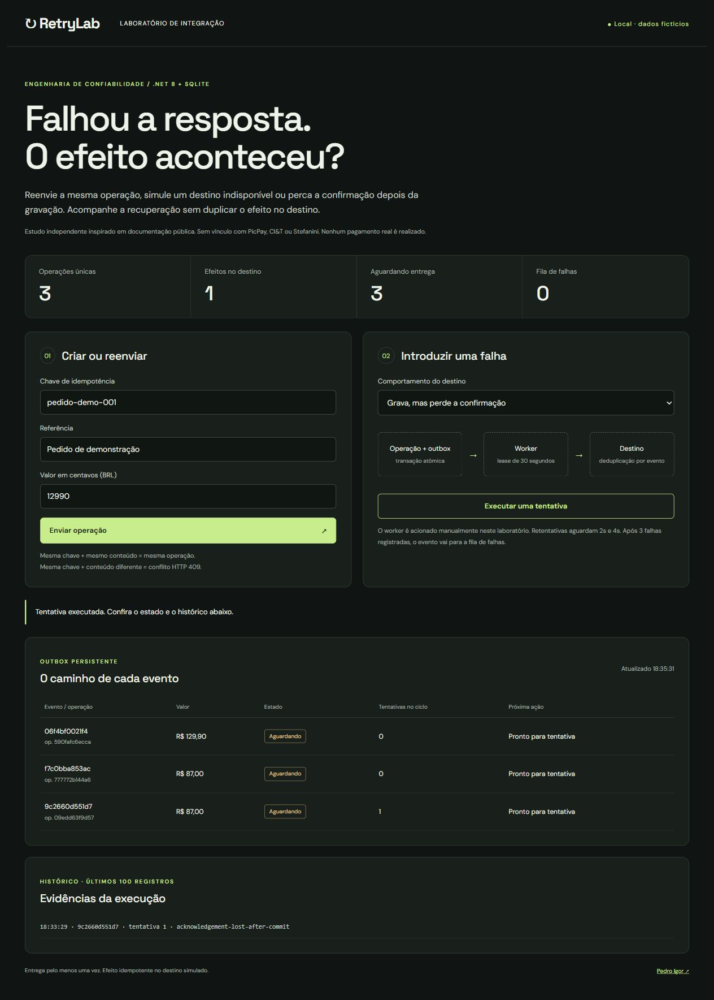
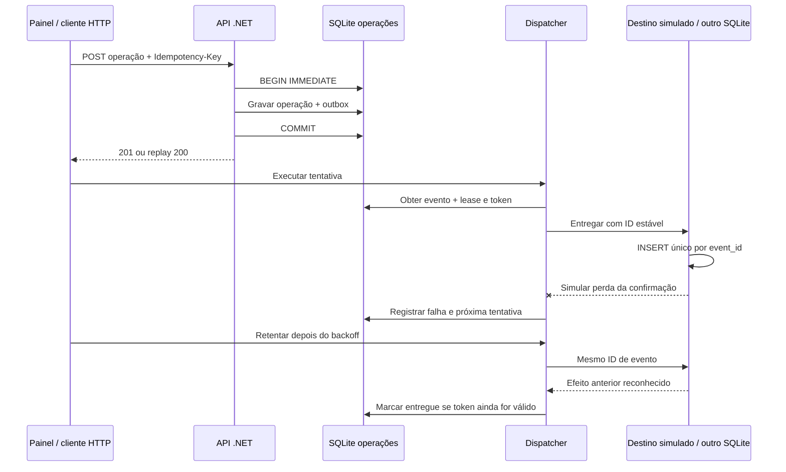

# RetryLab

**O destino gravou a operação, mas a resposta se perdeu. É seguro tentar outra vez?**

Um laboratório local de confiabilidade em C#/.NET 8. Você cria operações fictícias, provoca falhas na entrega e observa a recuperação. O foco é demonstrar decisões de integração que possam ser discutidas numa entrevista: transação, concorrência, idempotência e recuperação.



## Executar

Requisito: .NET SDK 8.0.418 (ou patch posterior da versão 8). O restore inicial usa NuGet. Não precisa de Docker, credenciais ou conta em nuvem.

```powershell
dotnet run --project src/RetryLab.csproj
# http://127.0.0.1:5284

dotnet test tests/RetryLab.Tests.csproj
python scripts/check_http.py  # com o servidor em execução; Python 3, só biblioteca padrão
```

Os bancos são criados em `src/data` quando executado com `dotnet run --project`. Estão no `.gitignore`. O processo escuta apenas no loopback. O painel usa fontes do Google com fallback para fontes do sistema; a API e o fluxo de simulação não dependem desse serviço.

## Roteiro de 90 segundos

1. Envie a operação com a chave sugerida. Reenvie sem alterar os campos: o contador não aumenta.
2. Altere o valor usando a mesma chave: a API responde 409. A operação original permanece.
3. Escolha **Grava, mas perde a confirmação** e execute uma tentativa. O destino tem um efeito; a outbox continua pendente.
4. Aguarde o prazo de retentativa, escolha **Saudável** e execute outra tentativa. O efeito no destino continua único; o evento fica entregue.
5. Para outro cenário, crie uma nova chave, escolha **Indisponível antes de gravar** e execute três tentativas respeitando o backoff de 2s e 4s. O evento vai para a fila de falhas.
6. Clique **Reabrir evento**, escolha **Saudável** e execute novamente. O histórico preserva o reprocessamento manual.

Com mais de um evento, o worker pega o elegível mais antigo por `due_at`. O botão executa uma tentativa por clique; não existe worker automático escondido.

## O que está implementado

| Caso | Mecanismo | Evidência |
|---|---|---|
| Mesmo pedido enviado em paralelo | Chave única + transação SQLite imediata | Teste com 24 chamadas em conexões independentes |
| Chave reutilizada com conteúdo diferente | Fingerprint SHA-256 do valor e referência | HTTP 409, sem nova operação |
| Processo falha entre operação e evento | Ambas as gravações na mesma transação | Trigger de falha injetada; rollback das duas tabelas |
| Destino grava e a confirmação se perde | ID de evento estável + unicidade no destino | Reenvio após reinício mantém um único efeito |
| Worker morre depois de obter o evento | Lease de 30s persistido | Relógio controlado recupera evento expirado |
| Worker antigo tenta confirmar | Token de posse comparado no UPDATE | Confirmação antiga é rejeitada |
| Falhas repetidas | Backoff exponencial limitado + fila de falhas após 3 falhas registradas | Teste sem sleeps usando TimeProvider |
| Operador reabre evento | Transição restrita a `dead`, auditada | Registro `manual-requeue` preservado |

São **12 casos de teste** (incluindo os três valores inválidos da teoria). Não representam benchmark de carga nem certificação de produção.

O modelo de GitHub Actions está em `docs/github-actions-ci.example.yml`. Ele não está ativo: a credencial usada na publicação não tem permissão para gravar workflows. Os resultados acima são locais. Para ativar depois, copie o modelo para `.github/workflows/ci.yml` com uma credencial apropriada.

## Arquitetura



### Decisões e limites

- O destino é um componente em processo com **outro arquivo de banco**, não um microsserviço HTTP. Isso permite provocar precisamente a perda da confirmação após o commit. Não há integração real com PicPay nem com qualquer empresa.
- A outbox registra a intenção de entrega atomicamente com a operação. A entrega pode ocorrer mais de uma vez. A unicidade do efeito depende da deduplicação do destino; não prometemos “exactly once” de ponta a ponta.
- SQLite simplifica a execução local e permite testar múltiplas conexões. Ele serializa escritores. Não demonstra throughput, PostgreSQL, Kafka nem distribuição entre máquinas.
- O lease não cancela efeitos externos de um worker antigo. O token protege o estado local e o receptor idempotente protege o efeito simulado.
- O limite de 3 vale para **falhas concluídas e registradas**, não garante no máximo 3 chamadas se processos morrerem repetidamente. Tentativas interrompidas aparecem no contador, mas só a conclusão entra no histórico. Para produção, registrar também início/expiração.
- Reabrir um evento zera o contador do ciclo, preservando o ID e o histórico. Não cria uma nova operação.
- O armazenamento da chave não tem TTL. Em produção, retenção deve ser definida pelo contrato de negócio; excluir cedo pode permitir duplicação tardia.
- Não há autenticação, autorização, multitenancy, TLS, HMAC de webhook ou integração financeira. Não exponha o servidor publicamente. O bloqueio de Origin limita chamadas de navegador, mas **não substitui autenticação**.
- O painel faz polling e exibe todos os eventos locais. Paginação, métricas exportáveis, tracing, jitter, rate limiting e monitoramento ficam fora deste recorte.
- Valores são inteiros em centavos e a moeda da demonstração é BRL. Nenhum dado de cliente ou dinheiro real é usado.

## De onde veio a ideia

A pesquisa completa e a distinção entre fato e hipótese estão em [docs/pesquisa.md](docs/pesquisa.md).

- **PicPay:** a [documentação de idempotência](https://developers-business.picpay.com/wallet/en/one-click/guides/idempotency-key) explica reenvios e duplicação de pagamentos/reembolsos. Inspirou o recorte de repetição segura. O laboratório não replica o contrato PicPay: usa `Idempotency-Key`, replay 200 e conflito 409.
- **CI&T:** o [case de transformação de um banco](https://ciandt.com/uk/en-gb/case-study/transforming-top-30-global-bank-its-digital-core) descreve gargalos de fluxo e evolução das práticas de testes/DevOps. A relação é demonstrar uma entrega pequena, reproduzível e verificável; **não** afirmar que uma outbox resolve aquele problema organizacional.
- **Stefanini:** a [publicação sobre cloud em clientes](https://stefanini.com/pt/newsroom/conheca-os-projetos-de-cloud-que-a-stefanini-technology-desenvolveu-para-diferentes-industrias/) trata de instabilidade, monitoramento e erros de configuração. O recorte aqui é tornar falha e recuperação observáveis, sem reproduzir a solução dos clientes.

Projeto independente de estudo/portfólio, sem vínculo, aprovação ou encomenda dessas empresas.

## API resumida

| Método | Rota | Uso |
|---|---|---|
| GET | `/health` | Saúde e indicação de simulação |
| GET | `/api/state` | Operações, outbox, efeitos e últimos 100 registros |
| POST | `/api/operations` | `{ "reference": "pedido", "amountCents": 12990 }` + header `Idempotency-Key` |
| POST | `/api/dispatch` | `{ "mode": "Healthy" }`, `Unavailable` ou `AcknowledgementLost` |
| POST | `/api/events/{id}/requeue` | Reabre somente evento na fila de falhas |

## Para conversar sobre o código

Antes de apresentar, percorra [docs/roteiro-tecnico.md](docs/roteiro-tecnico.md): ele reúne perguntas, arquivos e limitações que vale conseguir explicar. Revise o código e os testes para compreender e conseguir defender cada decisão.

Autor: [Pedro Igor](https://github.com/pedroigor-dev).
